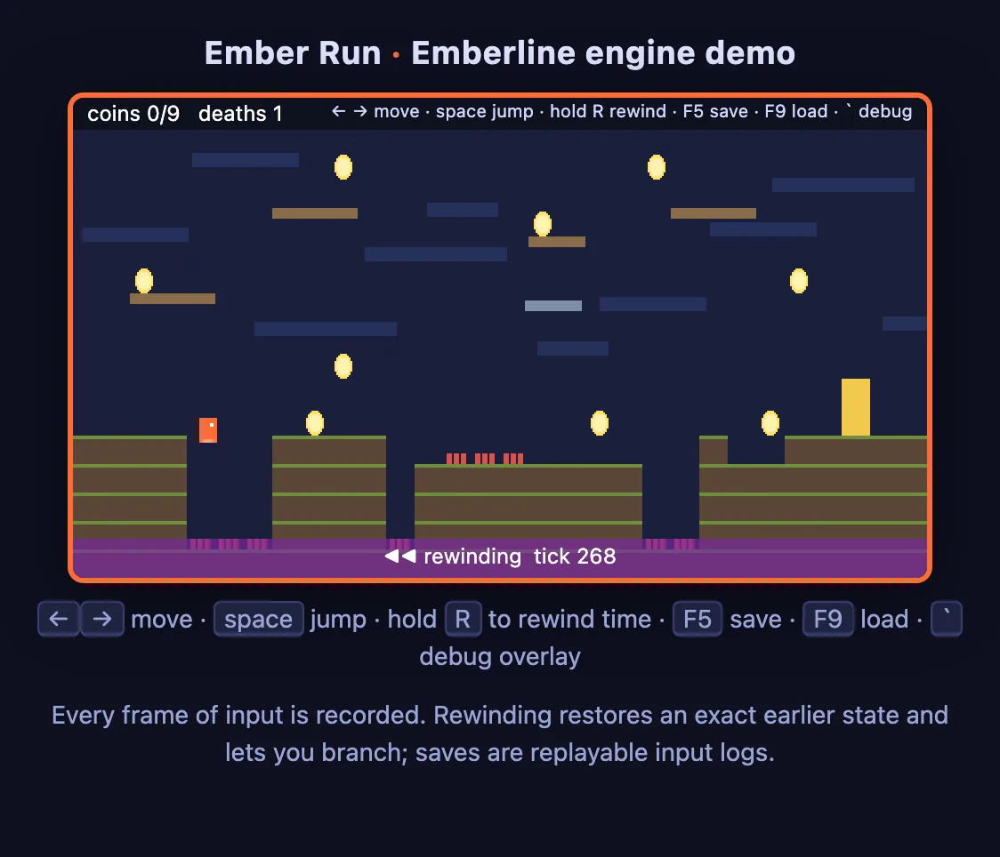
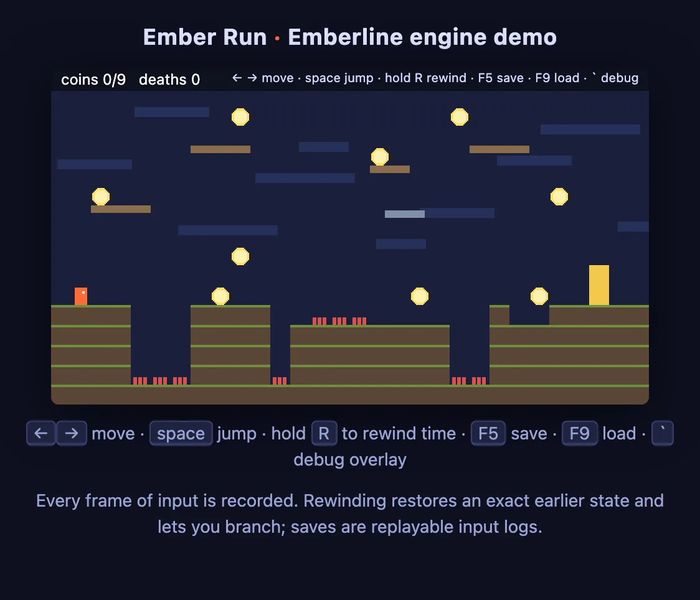

# Emberline

**A 2D game engine where time is a data structure.**

[Case study ↗](https://hellpuff.dev/work/emberline-engine)



*Real screenshot of the bundled* Ember Run *demo (`npm run demo`, Canvas2D) while R is held: the deterministic simulation is rewinding, and the banner shows the tick being restored.*

Emberline runs a fixed-step, deterministic simulation and records every
input frame. Because the state at any tick is a function of the starting
state and the inputs, the engine can rewind (hold R in the demo), replay a
run, and store a save file as a keyframe plus an input log that is checked by
replaying it. The headless demo uses the same rewind to let a bot finish the
level by searching ahead and backtracking.

TypeScript, zero runtime dependencies, Canvas2D renderer, ~1,300 lines of
engine (`src/`). Runs in the browser and headless in Node.

```
$ npm test
ℹ pass 24

$ npm run headless
search: level completed in 313 expansions, 206 ms, 189 states   # time varies by machine
tick 900: player at (427.8, 178.0), coins 2/9, deaths 0, won true
draw calls in one frame: 310
state hash: 65a217ed  (inputs: 900 ticks)
sounds in the winning run: jump coin jump jump coin jump win
fresh replay of the input log: identical
rewind 120 + replay: identical
save + load: identical
headless run OK
```

**Play it:** run `npm run demo` and open http://localhost:8000. *Ember Run* is a
platformer with coins, spikes, a moving platform and a goal. Arrow keys /
WASD move, Space jumps (variable height, coyote time), **hold R to rewind
time** and branch, F5/F9 save and load, `` ` `` shows the debug overlay
(fps, tick, entity count, state hash).

## Modules

| Module | What it gives you |
|---|---|
| `ecs` | Entities, JSON-only components, queries in deterministic id order, deep `snapshot`/`restore`, a per-tick event bus. |
| `timeline` | The core. `step(input)` runs systems at a fixed hz; keyframes every N ticks; `rewind(n)`, `seek(tick)`, `hash()`, `serialize()`/`deserialize()`; `GameLoop` with an accumulator and render interpolation. |
| `input` | Input frames as sorted, comparable data; `Keyboard` source with one-tick sticky taps; `ScriptedInput` for tests and bots; `pressed`/`released` edge helpers. |
| `physics` | AABB bodies, gravity, axis-separated collision resolution, `grounded`, bounce, ghosts, world bounds, `trigger` overlaps as events. |
| `scene` | Scenes own a world + systems + timeline; a `SceneManager` stack (menu → level → pause). |
| `render` / `canvas` | A small `Renderer` interface; a Canvas2D backend with camera, DPR-aware backing store, pixel snapping, sprite strips; a `NullRenderer` that records draw calls for tests. |
| `assets` | Manifest-driven loader with progress; `tools/pack` builds the manifest by reading PNG headers (no image library); `name@4.png` = 4-frame strip. |
| `audio` | Web Audio backend with lazy decoding; `NullAudio` records plays. Sounds are triggered from tick events, never from inside the simulation. |
| `script` | Named behaviours attached through a `script` component whose state is JSON, so scripted entities rewind and save like everything else. |
| `save` | `saveGame`/`loadGame`: keyframe + input log + hash; loading replays and refuses a file whose replay diverges. |
| `debug` | Frame stats, an overlay (fps, tick, history window, entity count, state hash), an entity inspector. |

## Why use it

It is aimed at games where rewind, replays and reproducible runs are part
of the design: precision platformers, puzzle games, roguelikes, or anything
where a save should be verifiable as a replay. General-purpose engines such
as Phaser or PixiJS leave determinism to you, and `Math.random()` or
`Date.now()` calls in game systems quietly break it. In Emberline the
simulation only sees its inputs and a seeded RNG, and a lint rule fails the
build if engine code reaches for wall-clock time, `Math.random` or the DOM.
Rendering is kept simple (Canvas2D rectangles and sprites); the timeline is
the part that matters.

What that gives you in practice:

- `timeline.rewind(60)` restores the exact state from one second earlier at
  60 Hz, and play continues on a new branch.
- A save is a keyframe plus the inputs since. Loading replays them through
  your systems and compares the recorded hash, so a save from a different
  build or an edited file is rejected. This is an integrity check, not a
  signature (see `SECURITY.md`).
- The headless bot completes the level by depth-first search over input
  options, backtracking with `rewind`, through the same code path a player
  uses.
- `npm run lint` fails if engine code touches `Math.random`, `Date.now`,
  `performance.now`, `new Date(` or the DOM outside the backends that own it.
- `GameLoop` renders with interpolation at any refresh rate from a 60 Hz
  simulation, and caps catch-up at 8 steps per frame so a background tab
  does not cause a spiral of death.

## What the tests cover

Identical hashes for identical inputs (and different ones for a different
seed); rewind to an exact earlier hash with future inputs dropped; seeking
that keeps the future; history bounds; save/load round trips and rejection of
edited files; property tests that replay, rewind, seek and save/load 60
random input logs each, including across history trimming; loop step
accounting; physics resolution on both axes with the contact side reported;
non-blocking triggers; keyboard sticky taps; asset packing from real PNG
bytes; scene stacking; audio from events; unregistered behaviours failing
with an error; and the demo server rejecting malformed URLs and path
traversal. CI also runs the headless demo end to end.

## Build, test, run

```
npm install            # typescript + @types/node only (dev)
npm test               # tsc, then node --test
npm run lint           # determinism / DOM-boundary lint
npm run headless       # bot plays the level, replay + save/load verified
npm run pack           # rebuild demo/assets/manifest.json from PNG headers
npm run demo           # http://localhost:8000
```

Node 20+. No bundler: the browser loads the compiled ES modules directly.
CI runs the tests, the headless demo and the asset packer on Ubuntu, Windows
and macOS with Node 20 and 22. The demo server listens on `127.0.0.1` only.

`npm run pack` rewrites `demo/assets/manifest.json` (currently `1 images, 0
sounds, 0 data files`: the sprite strip used by the demo).



*Real screenshot: Ember Run at its first frame, with coins, spikes, platforms and the goal.*

## Using it

Emberline is not published to npm. Build it from a clone and install the
packed tarball into your project:

```
npm ci && npm run build && npm pack      # writes emberline-0.1.0.tgz
cd ../your-game && npm install ../emberline-engine/emberline-0.1.0.tgz
```

The package exports `emberline` (engine) and `emberline/canvas`
(`CanvasRenderer`).

```ts
import { World, Timeline, physicsSystem, held, type Body, type System } from 'emberline';

const controls: System = {
  name: 'controls',
  update(world, ctx) {
    for (const e of world.query('body', 'player')) {
      const b = world.need<Body>(e, 'body');
      b.vx = held(ctx.input, 'ArrowRight') ? 120 : held(ctx.input, 'ArrowLeft') ? -120 : 0;
    }
  },
};
const world = new World();
world.create({ body: { x: 0, y: 200, w: 1000, h: 20, vx: 0, vy: 0, static: true } });
world.create({ body: { x: 10, y: 0, w: 10, h: 10, vx: 0, vy: 0 }, player: {} });
const timeline = new Timeline(world, [controls, physicsSystem({ gravity: 1000 })], { seed: 7 });
timeline.step({ keys: ['ArrowRight'] });
timeline.rewind(1);
```

## Limitations

- Canvas2D only: rectangles, sprites, text. No WebGL, lighting, particles
  or tilemap renderer (yet).
- AABB physics with static-vs-dynamic resolution; no dynamic-vs-dynamic
  response, slopes or rotation.
- Rewind history is bounded by `maxHistory` (default 5 minutes at 60 Hz);
  memory is proportional to world size × keyframes.
- Floating-point determinism holds across runs on the same engine; cross-
  platform bit-exactness is expected from JS semantics but not yet verified
  across browsers in CI.

## Documentation

- [`ARCHITECTURE.md`](ARCHITECTURE.md): the timeline model, keyframes, rewind, loop
- [`SECURITY.md`](SECURITY.md): save-file trust, determinism guarantees
- [`TESTING.md`](TESTING.md), [`ROADMAP.md`](ROADMAP.md), [`CONTRIBUTING.md`](CONTRIBUTING.md), [`CHANGELOG.md`](CHANGELOG.md)

## Contributing

See [`CONTRIBUTING.md`](CONTRIBUTING.md). Useful additions are listed in
[`ROADMAP.md`](ROADMAP.md): a tilemap renderer, particles, a gamepad input
source, a WebGL backend, or rollback netcode on top of the existing timeline.

## License

MIT. See [`LICENSE`](LICENSE).
